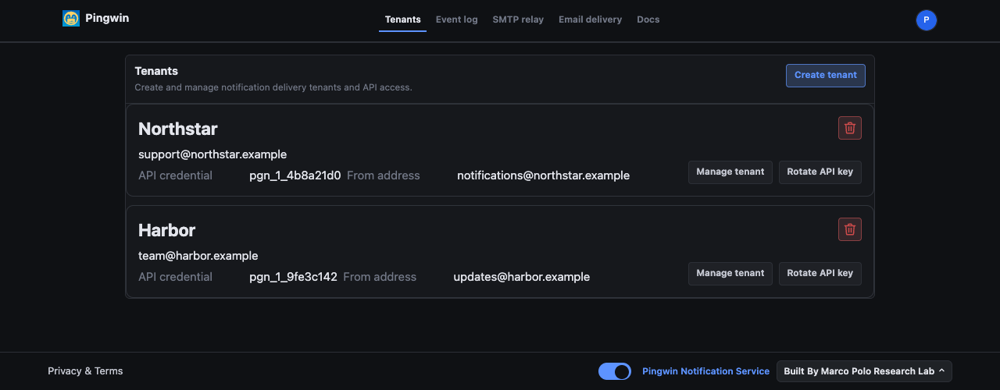
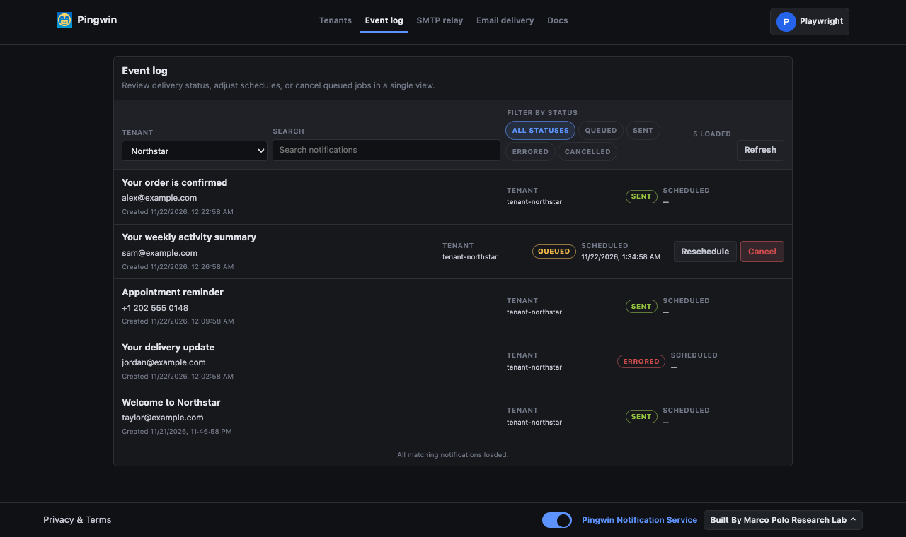
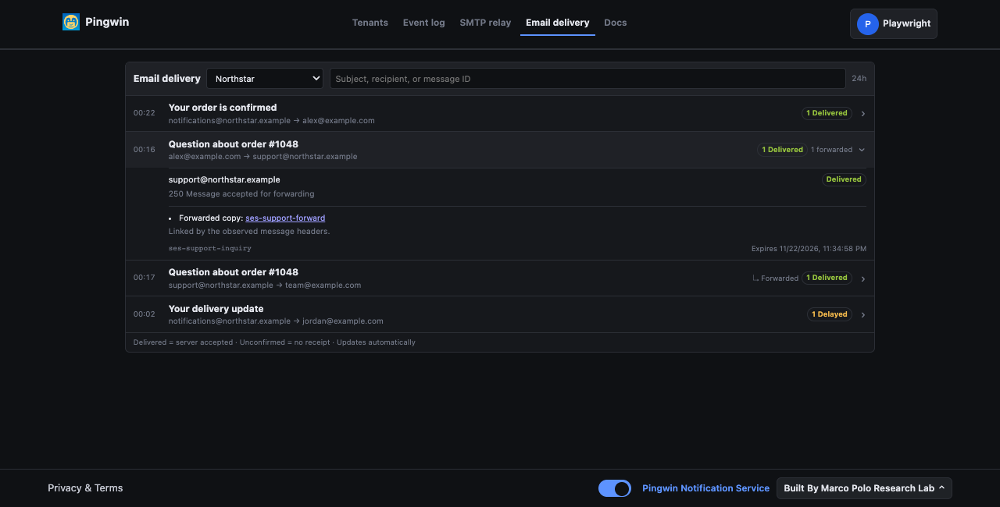

# Pingwin

Pingwin is a self-hosted service for application notifications and domain email routing.
Applications submit immediate or scheduled email and SMS notifications over gRPC.
Pingwin delivers email through each tenant's SMTP server and SMS through its Twilio account when configured.

Pingwin accepts authenticated SMTP submissions from clients such as Gmail Send-As.
It forwards mail sent to shared addresses to one or more existing inboxes.
In the browser workspace, you can manage tenants, credentials, notification records, and sender domains.

## Web workspace

These views use sample data.

Manage tenant delivery profiles and API access.



Review notification status and manage queued deliveries.



Inspect email delivery receipts and forwarding links.



## Capabilities and limits

| Capability | Current behavior |
| --- | --- |
| Schedules and retries | Pingwin stores notification records, including message content and attachments. A worker dispatches due requests and retries eligible failures with exponential backoff. |
| Attachments | Email notification requests accept up to 10 attachments, 5 MiB per file, and 25 MiB total. The full gRPC message limit is 32 MiB. |
| Tenant management | Signed-in users can create and manage their own Pingwin tenants. Each tenant has one rotatable API key. |
| SMTP submission | Verify sender domains and create credentials for individual sender addresses. Delivery uses an upstream relay or connects directly to recipient mail servers. |
| Direct SMTP | Each message can address one recipient domain. Pingwin provides no DKIM signer or bounce processor. |
| Shared addresses | Synchronous forwarding through a shared upstream relay. Pingwin stores no forwarded message body or mailbox state. |
| Email delivery history | Search the last 24 hours of SES delivery outcomes and observed forwarding links for the tenant's verified sender domains. Requires a configured read-only event source. |

Notification status `sent` records successful provider handoff. Check the destination to confirm receipt.
Status `errored` remains eligible for retries below the configured limit.
SMTP submission and forwarding use synchronous delivery, separate from the notification worker.
The [delivery guide](docs/smtp_delivery_plan.md) explains persistence, transport behavior, and duplicate-delivery risks.

Each tenant requires a complete external SMTP profile, even when its intended use is SMS or direct SMTP submission.
Provider secrets and SMTP identity passwords are encrypted at rest.
API secrets are stored as SHA-256 digests and displayed once.

Provider-backed mailboxes are planned.

## Quickstart

The local stack requires Docker Compose and a Google OAuth web client.
Use Go 1.25.4 or later to build the CLI for the first send.
Tenant creation also requires an external SMTP account.
SMS requires Twilio credentials.

1. Clone the repository and enter its root.

   ```bash
   git clone https://github.com/tyemirov/pingwin.git
   cd pingwin
   ```

2. Complete [local configuration](docs/getting-started.md#configure-the-local-stack).
   This step creates private environment files and configures web sign-in.
3. Start the stack.

   ```bash
   make up
   ```

4. Open [the local workspace](http://localhost:8080).
   Sign in and create a tenant with its SMTP profile.
   Save the API key when Pingwin displays it.
5. Complete [the first-send procedure](docs/getting-started.md#send-the-first-notification).
   Send an immediate email and inspect its returned status.
6. Stop the stack.

   ```bash
   make down
   ```

The [getting-started guide](docs/getting-started.md) includes ports, native startup, expected results, and failure diagnosis.

## Interfaces

[TAuth](https://github.com/tyemirov/TAuth) handles web sign-in and issues the session cookie.
Pingwin validates the cookie on management API requests and uses the session's user ID to check tenant ownership in its own database.

| Interface | Purpose | Authentication |
| --- | --- | --- |
| gRPC | Send, list, inspect, reschedule, and cancel notifications. | Tenant bearer API key. |
| HTTP management API | Manage tenants, profiles, credentials, notifications, and SMTP resources. | TAuth session cookie. |
| Browser | Tenants, Event log, SMTP relay, and Email delivery workspaces. | TAuth sign-in through the shared MPR UI. |
| SMTP submission | Send as one verified identity. | Identity-specific SMTP credentials. |
| SMTP forwarding | Receive mail for configured shared addresses. | Public listener with recipient restrictions. |

The gRPC namespace is `pingwin.NotificationService`.
The canonical schema is [pingwin.proto](pkg/proto/pingwin.proto).
The [API guide](docs/api.md) contains CLI examples, complete `grpcurl` commands, HTTP contracts, and notification status rules.

## Documentation

| Guide | Contents |
| --- | --- |
| [Configuration](docs/configuration.md) | Service settings, private inputs, tenant ownership, schema rules, doctor, and logs. |
| [SMTP setup](docs/smtp-setup.md) | DNS verification, Gmail Send-As, forwarding, listener limits, and gateway TLS. |
| [Delivery behavior](docs/smtp_delivery_plan.md) | Notification and SMTP delivery paths, storage, retries, and transport limits. |
| [SES delivery history](docs/ses-delivery-logging.md) | One-day event retention, delivery checks, forwarding correlation, and UI activation. |
| [Deployment](docs/deployment.md) | Release, publication, deployment, retained data, and production acceptance. |
| [Architecture](ARCHITECTURE.md) | Components, ownership, persistence, browser modules, and deployment boundaries. |
| [Managed tenant contract](docs/multitenancy-plan.md) | Resource schemas, API details, recovery evidence, and acceptance criteria. |
| [Shared UI migration](docs/mpr-ui-migration.md) | Shared-library qualification and production activation requirements. |

## Development

The Go backend uses GORM for database access with SQLite as its driver.
The browser uses ES modules, Alpine.js, and `mpr-ui`.
Run local validation through the repository Makefile. See [GitHub automation](.github/AUTOMATION.md).

```bash
make build
make test
make lint
make ci
```

`make ci` checks formatting and Go analysis, then runs the unit suite with the 100% Go statement coverage gate.
Select `make test-integration` for CLI, transport, and persistence checks.
Select `make test-frontend` for Playwright checks through a local API with controlled authentication responses.
The [development guide](docs/development.md) covers dependencies, test targets, protobuf generation, and visual baselines.

## License and commercial use

The repository uses the [PolyForm Noncommercial License 1.0.0](LICENSE), subject to the scope in [NOTICE](NOTICE).
The [commercial licensing notice](COMMERCIAL_LICENSE.md) describes separate written agreements through Marco Polo Research Lab LLC.
The contact address is legal@mprlab.com.
Contributions are subject to [CONTRIBUTOR_LICENSE.md](CONTRIBUTOR_LICENSE.md).
